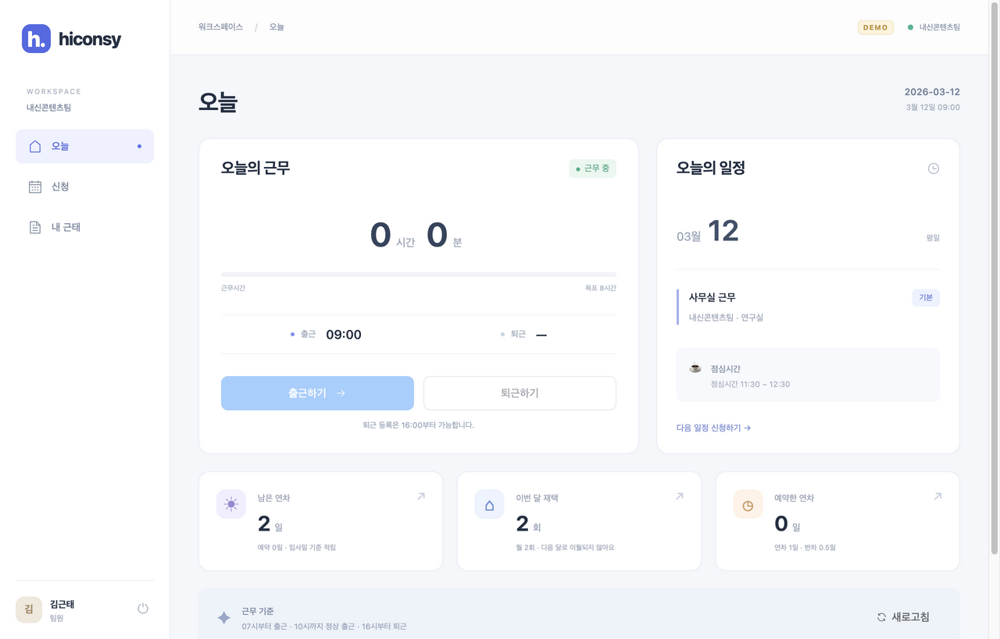
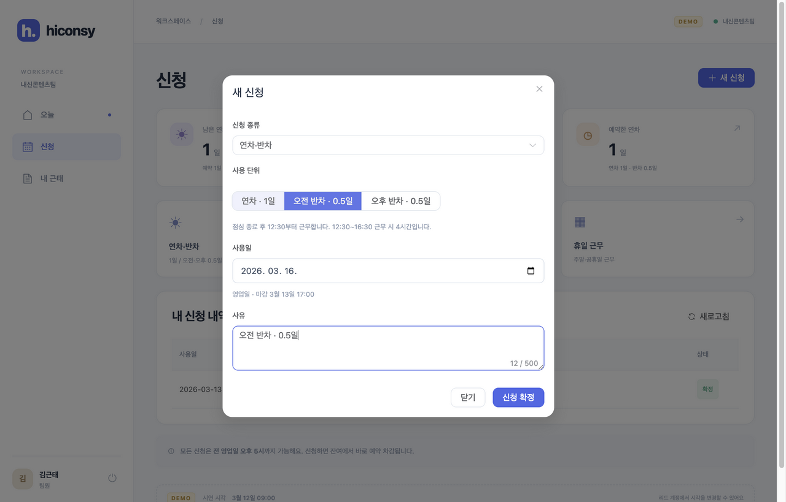
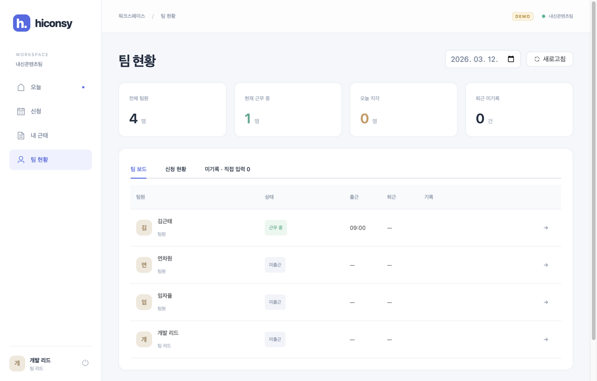
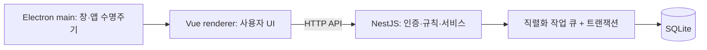
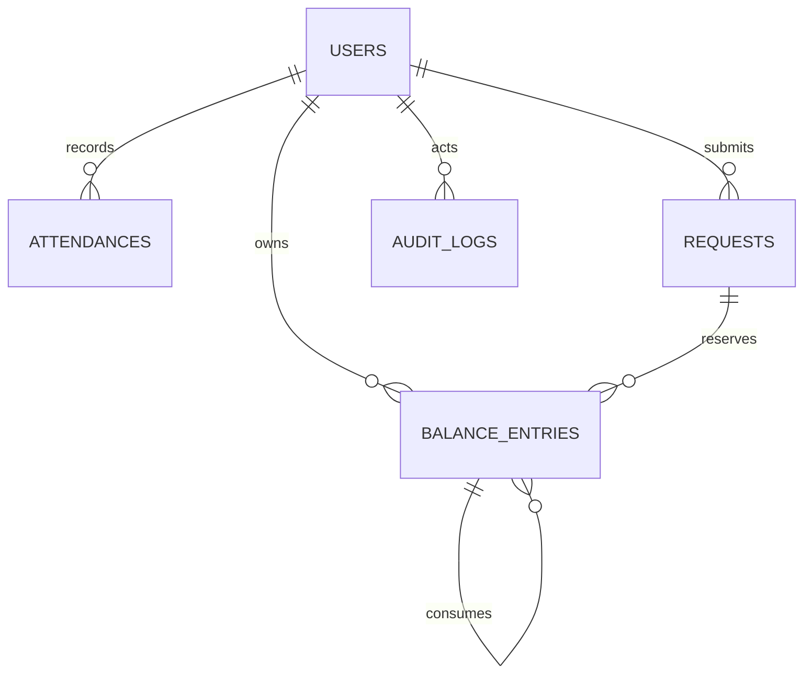

# Hiconsy Attendance

Vue 3 + NestJS 기반의 Electron 근태관리 앱입니다. 팀원은 출퇴근·휴가·재택근무를 관리하고, 리드는 같은 앱에서 팀 전체 현황을 확인합니다. SQLite를 사용하므로 별도 DB 서버가 필요하지 않습니다.

## 실행

**Node.js 24.11 이상(24.x)**, **npm 10.9 이상**이 필요합니다. Node 21은 지원하지 않습니다.

```sh
git clone https://github.com/hitchcoke/hiconsy-attendance.git
cd hiconsy-attendance
nvm install
nvm use
npm ci
npm run dev
```

`nvm`을 사용하지 않는다면 Node.js 24를 설치한 뒤 `npm ci`부터 실행합니다. Electron 바이너리는 설치 시 내려받습니다.

`npm run dev`는 NestJS(3000), Vite(5173), Electron을 함께 시작합니다. 최초 실행 시 DB와 샘플 계정이 생성됩니다. 시연 시각은 **2026-03-12 09:00 KST**이며 변경한 시각은 재실행 후에도 유지됩니다. 포트가 이미 사용 중이면 기존 프로세스를 종료해야 합니다.

| 계정 | 이름 | 역할 | 입사일 |
|---|---|---|---|
| `kim` | 김근태 | 팀원 | 2026-01-01 |
| `yeon` | 연차원 | 팀원 | 2026-01-15 |
| `im` | 임자율 | 팀원 | 2026-02-12 |
| `lead` | 개발 리드 | 리드 | 2026-01-01 |

공통 비밀번호는 `demo1234`입니다. 로그인 화면의 샘플 계정 버튼으로 입력할 수 있습니다.

### 시연 초기화

앱과 서버를 종료한 뒤 실행합니다. **시연 DB만 초기화**하며 일반 DB에는 적용되지 않습니다.

```sh
npm run demo:reset
npm run dev
```

실제 서버 시각으로 실행하려면 `npm run build` 후 `npm run server`를 실행하고, 별도 터미널에서 `npx electron .`을 실행합니다. 시연 모드와 일반 모드는 각각 `data/demo.sqlite`, `data/attendance.sqlite`를 사용합니다. 서버 재시작 시 다시 로그인해야 합니다.

## 구현 기능

- 출퇴근과 서버 시각 기준 지각·조퇴·순 근무시간 판정
- 미기록 퇴근 보정 및 직접 입력 이력
- 연차·오전 반차·오후 반차, 재택, 휴일 근무 신청
- 전 영업일 마감, 잔여·중복·월 재택 한도 검증
- 팀원 본인 화면과 리드의 팀 보드·상세·미기록 조회
- 연구실 IP 및 개인 신청 IP·시간대 검사
- 업무 요청의 성공·실패 이력과 리드 전용 시연 시계

관리자 화면, 규칙 편집, 승인·반려, 신청 수정·취소, PDF, 월 정산은 구현 범위에서 제외했습니다.





## 연차와 반차

사용자 요청에 따라 초기 과제의 별도 OFF를 **연차 잔여에 통합**했습니다. 휴일 근무 완료 시 0.5일을 적립하고, 이 적립분의 30일 만료는 유지합니다.

| 구분 | 차감 | 근무 기준 |
|---|---:|---|
| 연차 | 1일 | 출퇴근 대상 제외 |
| 오전 반차 | 0.5일 | 점심 종료 **12:30부터 출근**, 12:30 초과 지각, 4시간 기준 |
| 오후 반차 | 0.5일 | 점심 시작 **11:30부터 퇴근 등록**, 근무 인정은 11:30까지, 4시간 기준 |

오전 반차의 정상 근무 예시는 **12:30~16:30**, 오후 반차는 **07:30~11:30**입니다. 유연 출근 제도와 반차의 4시간 기준을 함께 적용했으므로, 오후 반차에 09:00 출근한 경우 인정 근무는 2시간 30분입니다. 늦게 퇴근을 등록해도 오후 시간이 추가되지 않습니다.

- 평일 기본: 07:00부터 출근, 10:00:00 초과 지각, 16:00부터 퇴근, 8시간 기준.
- 11:30~12:30 전체가 근무 구간에 포함될 때만 점심 1시간을 제외합니다.
- 연차는 입사 한 달 후부터 매월 입사일에 1일분 적립합니다. 월말 입사일은 해당 월의 마지막 날로 보정합니다.
- 신청은 전 영업일 17:00 정각까지이며 즉시 확정됩니다. 하루 한 종류만 신청합니다.
- 지급된 잔여만 예약할 수 있습니다. 사용일까지 유효한 만료 임박 적립분을 먼저 차감합니다.
- 재택은 사용일 기준 월 2회이며 이월하지 않습니다.
- 휴일 근무는 신청한 IP·시간대가 모두 맞아야 합니다. 보상은 퇴근 완료 시 한 번 지급됩니다.
- 공휴일 데이터는 **2026년**을 지원합니다. 다른 연도는 오류를 반환하며 데이터 확장이 필요합니다.

상세 해석은 [명세](docs/spec.md)를 참고하세요. 기존 개발 DB의 OFF 신청은 오후 반차로 이관하고 이미 확정된 근무시간·판정은 보존합니다.

## 구조와 기술 선택



| 기술 | 선택 이유 |
|---|---|
| Vue 3 + TypeScript | 컴포넌트와 공통 API 타입으로 화면을 구성 |
| Vue Router + Pinia | 패키징에서도 동작하는 해시 라우팅, 로그인 상태 공유 |
| Element Plus | 폼·표·다이얼로그를 일관되게 구현 |
| Electron + Forge | 웹 UI를 데스크톱 앱으로 실행·패키징 |
| NestJS | HTTP 경계와 업무 기능 분리, 테스트 가능한 서버 생성 |
| TypeORM + SQLite | 외부 DB 설치 없이 관계·제약·마이그레이션·트랜잭션 사용 |
| Node test + Supertest + Playwright | 규칙·HTTP 통합·실제 Electron UI 검증 |

`src/ui`는 화면·API 클라이언트, `src/shared`는 공통 계약, `src/server`는 도메인별 기능, `electron`은 창 관리, `scripts`는 실행·검증 도구입니다. 근태 계산은 서버에서만 수행합니다.

단일 서버 프로세스를 전제로 DB 검증과 쓰기를 직렬화합니다. 신청 생성·차감·성공 이력은 한 트랜잭션에 포함되며, 실패 시 롤백 후 실패 이력을 저장합니다. 서버를 여러 개로 확장할 때는 세션 공유와 DB 동시성 구조를 변경해야 합니다.

인증은 난수 세션 토큰(실제 시각 기준 8시간), 비밀번호는 scrypt 해시입니다. 팀원 접근은 본인 데이터로 제한하고 리드 권한은 서버에서 검사합니다. 프록시 전달 IP를 신뢰하지 않고 실제 연결 IP를 사용합니다. Electron의 Node 통합은 끄고 컨텍스트를 분리했습니다.

### DB 설계



| 테이블 | 설계 이유 |
|---|---|
| `users` | 역할과 입사일이 권한·연차 적립의 기준 |
| `attendances` | 사용자·근무일 유일 제약으로 중복 출근 방지, 원시 시각과 판정 보존 |
| `requests` | 사용자·사용일 유일 제약, 종류와 원격 근무 IP·시간대 보존 |
| `balance_entries` | 지급과 차감을 별도 기록. **정수 1단위=0.5일**로 소수 오차 방지. 원본 지급 행에 차감을 연결해 만료 추적 |
| `holidays` | 영업일과 신청 마감 계산 |
| `audit_logs` | 성공·실패 추적. 비밀번호·토큰·요청 본문은 기록하지 않음 |
| `app_settings` | 시연 시각 유지 |

월 적립은 +2단위, 휴일 근무 보상은 +1단위입니다. 연차는 -2, 반차는 -1이며 한 신청이 여러 적립분을 사용할 수 있습니다. 지급 원인 키는 유일하게 유지합니다. DB 생성은 마이그레이션으로 처리하고 `synchronize`는 사용하지 않습니다.

[DB·API 계약](docs/contracts.md) · [Task 목록](docs/tasks/README.md)

### 컨벤션

- 도메인별 서버 모듈, PascalCase Vue 화면·컴포넌트, 공유 DTO는 `src/shared`.
- 시각은 UTC ISO로 저장하고 업무 날짜는 KST `YYYY-MM-DD`, 근무시간은 정수 초.
- 오류는 `{code, message}`와 HTTP 상태로 반환하고 화면은 사용자 안내를 표시.
- Prettier 사용. `npm run format:check`로 확인.
- `task/Txx-name` 브랜치 → 기능 커밋 → 검증 → `--no-ff` 병합. 기존 이력은 다시 쓰지 않음.

## 검증

```sh
npm test                 # 서버 규칙·API·마이그레이션·재시작 보존
npm run build            # 서버 및 Vue 타입 검사·빌드
npm run format:check
npm run test:ui          # 실제 Electron 시나리오, 3000 포트 비어 있어야 함
```

UI 테스트는 임시 SQLite DB로 실행하고 종료 시 삭제합니다. 결과와 화면 캡처는 `artifacts/ui`에 남습니다. [검증 기록](docs/qa.md)을 확인하세요.

## 패키징

```sh
npm run make
npm run server:demo
```

`out/`의 앱을 실행합니다. ZIP은 `out/make/zip/darwin/arm64/`에 생성됩니다. **앱에는 사용자 UI만 포함되므로 NestJS 서버는 별도로 실행해야 합니다.** macOS Apple Silicon에서 패키징·실행 검증했으며 Windows/Linux는 검증하지 않았습니다. 코드 서명·공증·자동 업데이트는 포함하지 않습니다.

다른 서버에 연결하려면 `.env`의 `VITE_API_URL`을 설정한 뒤 앱을 다시 빌드합니다. 서버의 `HOST`, `OFFICE_IPS`, `PORT`, `DB_PATH`는 환경변수로 설정합니다. 앱 자산은 로컬에 포함되고 API 주소는 빌드 시 CSP에도 반영됩니다.

## Git 이력 데이터

- [Task별 완료 기록](docs/tasks/README.md)
- [커밋·병합 기록](docs/history.md)
- [기계 판독용 JSON](docs/history.json)

```sh
npm run history:export
```

현재 Git에서 실제 커밋 SHA·부모·브랜치·병합 기록을 추출합니다. 스냅샷의 `head`까지 포함하며 스냅샷 자체를 기록하는 커밋은 다음 생성 때 반영됩니다.
