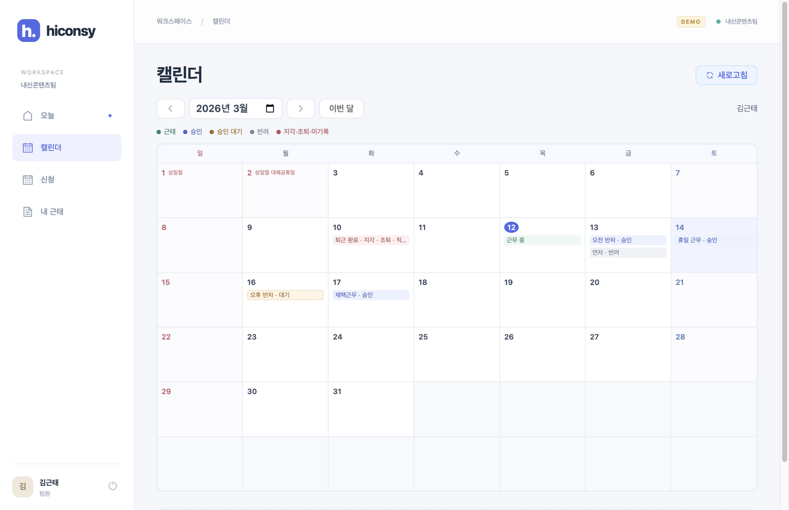
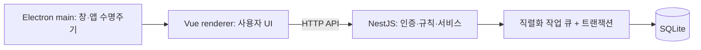
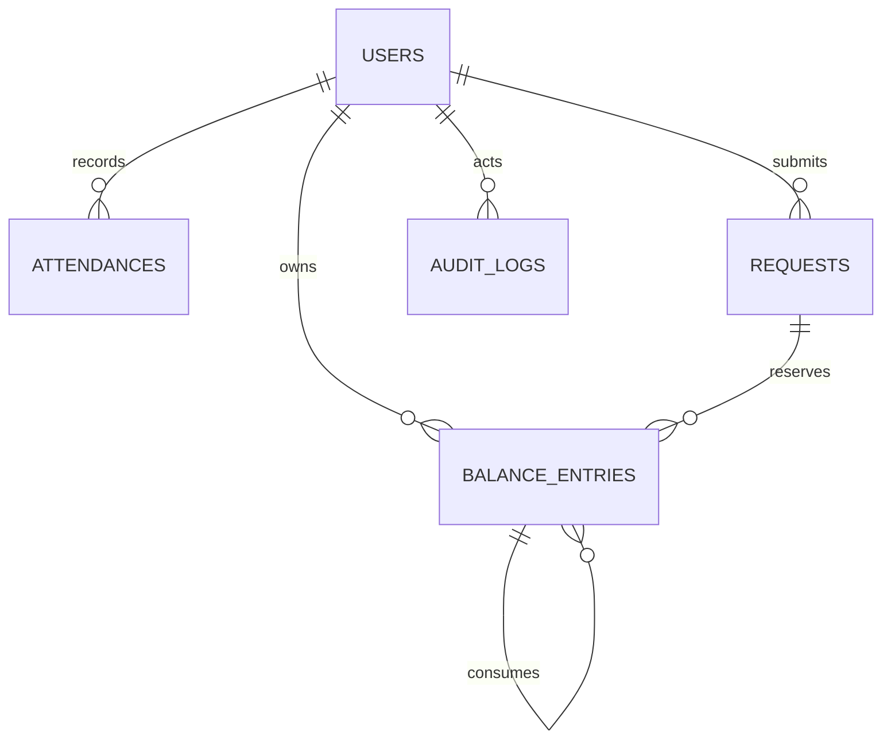

# Hiconsy Attendance

Vue 3 + NestJS 기반의 Electron 근태관리 앱입니다. 팀원은 출퇴근·휴가·재택근무를 관리하고, 리드는 같은 앱에서 팀원 휴가를 승인·반려하고 팀 전체 현황을 확인합니다. SQLite를 사용하므로 별도 DB 서버가 필요하지 않습니다.

## 실행

**Node.js 24.11 이상(24.x)**, **npm 10.9 이상**이 필요합니다. Node 21은 지원하지 않습니다.

```sh
git clone https://github.com/hitchcoke/hiconsy-attendance.git
cd hiconsy-attendance
nvm install
nvm use
npm ci
npm run dev
```

`nvm`을 사용하지 않는다면 Node.js 24를 설치한 뒤 `npm ci`부터 실행합니다. Electron 바이너리는 설치 시 내려받습니다.

현재 Node 버전이 다르거나 `nvm`이 없다면 다음 명령으로 이 프로젝트에 필요한 버전을 사용합니다. 첫 실행에는 런타임을 내려받으며, 시스템 기본 Node 버전은 변경하지 않습니다.

```sh
npx --yes --package=node@24 --package=npm@10.9.4 -- npm ci
npx --yes --package=node@24 --package=npm@10.9.4 -- npm run dev
```

이미 의존성을 설치했다면 두 번째 명령만 실행하면 됩니다. `crypto.hash is not a function`은 지원하지 않는 Node 버전으로 Vite를 시작했을 때 발생할 수 있습니다. `node -v`로 현재 버전을 확인하세요. 개발 실행 스크립트도 시작 전에 버전을 검사합니다.

`npm run dev`는 NestJS(3000), Vite(5173), Electron을 함께 시작합니다. 최초 실행 시 DB와 샘플 계정이 생성됩니다. 시연 시각은 **2026-03-12 09:00 KST**이며 변경한 시각은 재실행 후에도 유지됩니다. 포트가 이미 사용 중이면 기존 프로세스를 종료해야 합니다.

| 계정 | 이름 | 역할 | 입사일 |
|---|---|---|---|
| `kim` | 김근태 | 팀원 | 2026-01-01 |
| `yeon` | 연차원 | 팀원 | 2026-01-15 |
| `im` | 임자율 | 팀원 | 2026-02-12 |
| `lead` | 개발 리드 | 리드 | 2026-01-01 |

공통 비밀번호는 `demo1234`입니다. 로그인 화면의 샘플 계정 버튼으로 입력할 수 있습니다.

### 시연 초기화

앱과 서버를 종료한 뒤 실행합니다. **시연 DB만 초기화**하며 일반 DB에는 적용되지 않습니다.

```sh
npm run demo:reset
npm run dev
```

실제 서버 시각으로 실행하려면 `npm run build` 후 `npm run server`를 실행하고, 별도 터미널에서 `npx electron .`을 실행합니다. 시연 모드와 일반 모드는 각각 `data/demo.sqlite`, `data/attendance.sqlite`를 사용합니다. 서버 재시작 시 다시 로그인해야 합니다.

## 구현 기능

- 출퇴근과 서버 시각 기준 지각·조퇴·순 근무시간 판정
- 미기록 퇴근 보정 및 직접 입력 이력
- 연차·오전 반차·오후 반차, 재택, 휴일 근무 신청
- 팀원 휴가 승인 대기 → 리드 승인·반려 → 결과 확인·반려 잔여 반환
- 전 영업일 마감, 잔여·중복·월 재택 한도 검증
- 팀원 본인 화면과 리드의 팀 보드·상세·미기록 조회
- 월간 캘린더에서 근태·연차·오전/오후 반차·승인 상태 확인, 날짜 선택 후 신청
- 연구실 IP 및 개인 신청 IP·시간대 검사
- 업무 요청의 성공·실패 이력과 리드 전용 시연 시계

관리자 화면, 규칙 편집, 신청 수정·취소, PDF, 월 정산은 구현 범위에서 제외했습니다.





## 휴가 신청과 승인

1. 팀원: **신청 → 연차·반차 → 승인 요청**. 잔여를 예약하고 내역에 **승인 대기**가 표시됩니다.
2. 리드: **휴가 승인 → 검토**에서 신청자·날짜·사유를 확인하고 승인 또는 반려합니다. 반려 사유는 필수입니다.
3. 팀원: **내 신청 내역**에서 결과와 처리 사유를 확인합니다. 승인은 추가 차감 없이 휴가를 적용하고 반려는 예약을 반환합니다.
4. 반려된 신청은 이력으로 남습니다. 신청 마감 전이면 같은 날짜에 다시 신청할 수 있습니다.

승인 전에는 기존 근무 기준을 따릅니다. 이미 출근한 날이나 지난 날짜는 승인할 수 없으며 반려로 정리할 수 있습니다. 반환한 휴일 보상의 원래 만료일은 유지됩니다.

[승인 목록 화면](docs/screenshots/approvals.png) · [팀원 처리 결과](docs/screenshots/requests-reviewed.png)

리드 1명인 샘플 조직이므로 **리드 본인 휴가와 재택·휴일 근무 신청은 자동 확정**합니다. 이전 버전에서 확정된 신청도 승인 상태로 보존합니다.

## 연차와 반차

사용자 요청에 따라 초기 과제의 별도 OFF를 **연차 잔여에 통합**했습니다. 휴일 근무 완료 시 0.5일을 적립하고, 이 적립분의 30일 만료는 유지합니다.

| 구분 | 차감 | 근무 기준 |
|---|---:|---|
| 연차 | 1일 | 출퇴근 대상 제외 |
| 오전 반차 | 0.5일 | 점심 종료 **12:30부터 출근**, 12:30 초과 지각, 4시간 기준 |
| 오후 반차 | 0.5일 | 점심 시작 **11:30부터 퇴근 등록**, 근무 인정은 11:30까지, 4시간 기준 |

오전 반차의 정상 근무 예시는 **12:30~16:30**, 오후 반차는 **07:30~11:30**입니다. 유연 출근 제도와 반차의 4시간 기준을 함께 적용했으므로, 오후 반차에 09:00 출근한 경우 인정 근무는 2시간 30분입니다. 늦게 퇴근을 등록해도 오후 시간이 추가되지 않습니다.

- 평일 기본: 07:00부터 출근, 10:00:00 초과 지각, 16:00부터 퇴근, 8시간 기준.
- 11:30~12:30 전체가 근무 구간에 포함될 때만 점심 1시간을 제외합니다.
- 연차는 입사 한 달 후부터 매월 입사일에 1일분 적립합니다. 월말 입사일은 해당 월의 마지막 날로 보정합니다.
- 신청은 전 영업일 17:00 정각까지입니다. 팀원 휴가는 리드 승인 후 적용하며, 같은 날 대기·승인된 신청은 하나만 가능합니다. 반려 후에는 마감 전 재신청할 수 있습니다.
- 지급된 잔여만 예약할 수 있습니다. 사용일까지 유효한 만료 임박 적립분을 먼저 차감합니다.
- 재택은 사용일 기준 월 2회이며 이월하지 않습니다.
- 휴일 근무는 신청한 IP·시간대가 모두 맞아야 합니다. 보상은 퇴근 완료 시 한 번 지급됩니다.
- 공휴일 데이터는 **2026년**을 지원합니다. 다른 연도는 오류를 반환하며 데이터 확장이 필요합니다.

상세 해석은 [명세](docs/spec.md)를 참고하세요. 기존 개발 DB의 OFF 신청은 오후 반차로 이관하고 이미 확정된 근무시간·판정은 보존합니다.

## 캘린더

1. **캘린더** 메뉴에서 월을 이동하거나 **이번 달**로 돌아갑니다. 기준은 PC 시각이 아닌 서버의 한국 시각입니다.
2. 날짜를 누르면 출퇴근 시각·근무시간과 신청 내역이 열립니다. 오전/오후 반차, 승인 대기·승인·반려를 구분하며 반려 후 재신청 이력도 남습니다.
3. **이 날짜로 신청**을 누르면 선택일이 입력된 신청 폼이 열립니다. 제출하면 같은 날짜의 상세로 돌아옵니다. 마감·중복 등 신청 불가 사유도 표시합니다.
4. 리드는 **조회 대상**에서 팀원을 선택할 수 있습니다. 신청은 본인의 일정에서만 가능합니다.

방향키로 날짜를 이동하고 Enter로 상세를 열며 Escape로 닫습니다. 공휴일과 달력 조회 범위는 2026년입니다. 날짜 변경·드래그 편집·외부 캘린더 연동은 제공하지 않습니다. [날짜 상세](docs/screenshots/calendar-detail.png) · [작은 창](docs/screenshots/calendar-minimum.png)

## 구조와 기술 선택



| 기술 | 선택 이유 |
|---|---|
| Vue 3 + TypeScript | 컴포넌트와 공통 API 타입으로 화면을 구성 |
| Vue Router + Pinia | 패키징에서도 동작하는 해시 라우팅, 로그인 상태 공유 |
| Element Plus | 폼·표·다이얼로그를 일관되게 구현 |
| Electron + Forge | 웹 UI를 데스크톱 앱으로 실행·패키징 |
| NestJS | HTTP 경계와 업무 기능 분리, 테스트 가능한 서버 생성 |
| TypeORM + SQLite | 외부 DB 설치 없이 관계·제약·마이그레이션·트랜잭션 사용 |
| Node test + Supertest + Playwright | 규칙·HTTP 통합·실제 Electron UI 검증 |

`src/ui`는 화면·API 클라이언트, `src/shared`는 공통 계약, `src/server`는 도메인별 기능, `electron`은 창 관리, `scripts`는 실행·검증 도구입니다. 근태 계산은 서버에서만 수행합니다.

단일 서버 프로세스를 전제로 DB 검증과 쓰기를 직렬화합니다. 신청 생성·차감·성공 이력은 한 트랜잭션에 포함되며, 실패 시 롤백 후 실패 이력을 저장합니다. 서버를 여러 개로 확장할 때는 세션 공유와 DB 동시성 구조를 변경해야 합니다.

인증은 난수 세션 토큰(실제 시각 기준 8시간), 비밀번호는 scrypt 해시입니다. 팀원 접근은 본인 데이터로 제한하고 리드 권한은 서버에서 검사합니다. 프록시 전달 IP를 신뢰하지 않고 실제 연결 IP를 사용합니다. Electron의 Node 통합은 끄고 컨텍스트를 분리했습니다.

### DB 설계



| 테이블 | 설계 이유 |
|---|---|
| `users` | 역할과 입사일이 권한·연차 적립의 기준 |
| `attendances` | 사용자·근무일 유일 제약으로 중복 출근 방지, 원시 시각과 판정 보존 |
| `requests` | 대기/승인에만 사용자·사용일 유일 제약 적용. 신청·심사자·상태·사유와 원격 근무 조건 보존 |
| `balance_entries` | 지급과 차감을 별도 기록. **정수 1단위=0.5일**로 소수 오차 방지. 원본 지급 행에 차감을 연결해 만료 추적 |
| `holidays` | 영업일과 신청 마감 계산 |
| `audit_logs` | 성공·실패 추적. 비밀번호·토큰·요청 본문은 기록하지 않음 |
| `app_settings` | 시연 시각 유지 |

월 적립은 +2단위, 휴일 근무 보상은 +1단위입니다. 연차는 -2, 반차는 -1이며 한 신청이 여러 적립분을 사용할 수 있습니다. 지급 원인 키는 유일하게 유지합니다. DB 생성은 마이그레이션으로 처리하고 `synchronize`는 사용하지 않습니다.

[DB·API 계약](docs/contracts.md) · [Task 목록](docs/tasks/README.md)

### 컨벤션

- 도메인별 서버 모듈, PascalCase Vue 화면·컴포넌트, 공유 DTO는 `src/shared`.
- 시각은 UTC ISO로 저장하고 업무 날짜는 KST `YYYY-MM-DD`, 근무시간은 정수 초.
- 오류는 `{code, message}`와 HTTP 상태로 반환하고 화면은 사용자 안내를 표시.
- Prettier 사용. `npm run format:check`로 확인.
- `task/Txx-name` 브랜치 → 기능 커밋 → 검증 → `--no-ff` 병합. 기존 이력은 다시 쓰지 않음.

## 개발 시 고민했던 점과 아쉬운 점

### 목록 중심 화면을 캘린더로 보완

초기에는 요구사항의 출퇴근·신청·근태 조회를 개별 화면과 목록으로 구현하는 데 집중했습니다. 기능은 사용할 수 있었지만 한 달 동안의 근무와 휴가를 한눈에 파악하기 어렵고, 원하는 날짜를 확인한 뒤 신청 화면에서 다시 입력해야 하는 점이 아쉬웠습니다. 근태관리에서는 날짜별 일정을 이해하는 시각적 표현과 신청까지 이어지는 동작이 함께 필요하다고 판단해 월간 캘린더를 추가했습니다.

캘린더에서 오전·오후 반차와 승인 상태를 구분하고, 날짜 상세에서 바로 신청한 뒤 같은 날짜로 돌아오도록 연결했습니다. 별도 일정 데이터를 복제하지 않고 기존 근태·신청 데이터를 조회해 목록과 달력의 결과가 일치하도록 했습니다. 작은 창에서 이력이 길어지면 신청 버튼이 아래로 밀리는 문제도 확인해, 마감 안내와 신청 영역을 상세 하단에 고정했습니다.

### 앱 밖으로 이어지는 일정 공유

향후에는 승인된 휴가·근무 일정을 메일이나 외부 캘린더로 공유하고, 메신저에서도 신청 결과를 확인할 수 있도록 확장하고 싶습니다. 이를 위한 후보로 [iCalendar(RFC 5545)](https://www.rfc-editor.org/rfc/rfc5545.html) 형식의 `.ics` 내보내기·구독 API와 메일·메신저 서비스 API 연동을 고려했습니다. 일정 데이터의 교환 형식과 각 서비스로 전달하는 기능을 나누면 앱 외부에서도 같은 일정을 활용할 수 있습니다.

[iCal4j](https://www.ical4j.org/)는 iCalendar 표준을 처리하는 Java 라이브러리입니다. 현재 서버는 NestJS/Node.js이므로, 실제 도입 시에는 Node.js에서 사용할 수 있는 구현을 검토하거나 iCal4j를 사용하는 별도 연동 서비스를 구성할지 판단해야 합니다. 현재 구현 범위는 앱 내부 캘린더와 조회 API까지이며, 외부 연동은 향후 개선 과제로 남겼습니다. 연동할 때는 승인 대기와 확정 일정을 구분하고, 오전·오후 반차의 시간대, 일정 식별자, 변경·취소 반영, 알림 재전송 시 중복 방지도 함께 설계해야 합니다.

### 반차·승인 상태·잔여를 함께 다루는 문제

연차와 휴일 근무 보상을 하나의 잔여로 합치면서, 반차를 단순히 0.5일 차감하는 것만으로는 충분하지 않았습니다. 오전 반차는 점심 종료 후 출근하고 오후 반차는 점심 시작 전까지만 근무를 인정하므로, 신청 종류가 지각·조퇴 판정에도 연결되어야 했습니다. 잔여는 정수 반일 단위로 저장하고, 오전·오후에 적용할 근무 기준은 서버에서 구분했습니다.

승인 절차를 추가할 때는 대기 중인 신청이 잔여를 얼마나 점유할지와 반려 후 복구 방식이 고민이었습니다. 신청 시 잔여를 예약하고 승인 시 추가 차감 없이 적용하며, 반려 시 원래 지급분에 반환하도록 정했습니다. 특히 휴일 근무 보상은 반환하더라도 원래 만료일이 유지되어야 하므로, 잔여 숫자만 변경하는 대신 지급·예약·반환 내역의 연결을 남겼습니다. 같은 날짜의 반려 이력과 재신청도 함께 보존했습니다.

### 시간 경계와 화면 간 일관성

10:00 정각과 직후의 출근, 전 영업일 17:00 신청 마감, 월말 입사자의 연차 지급처럼 경계에서 결과가 달라지는 규칙을 일관되게 처리하는 것이 중요했습니다. 클라이언트마다 다시 계산하면 오늘 화면·신청 화면·캘린더의 결과가 달라질 수 있어, 업무 시각과 판정을 서버로 모으고 화면은 판정 결과와 불가 사유를 표시하도록 했습니다.

시연 중에도 같은 조건을 재현할 수 있도록 업무용 시계를 분리하되, 로그인 만료는 실제 시각을 사용했습니다. 규칙은 경계값과 동시 요청 테스트로 확인하고, 사용자 흐름은 실제 Electron에서 신청·승인·복귀까지 이어서 검증했습니다. 빠르게 월을 바꾸는 경우의 응답 순서나 최소 창에서의 버튼 위치처럼 API 테스트만으로 확인하기 어려운 부분도 따로 점검했습니다.

### 간단한 실행과 운영 확장 사이의 선택

별도 DB 서버 설치 없이도 재시작 후 기록을 유지하고 신청·잔여·이력을 함께 저장할 수 있도록 SQLite를 선택했습니다. Electron은 창과 화면 실행을 맡고 업무 처리는 NestJS에 두어, 사용자 화면과 근태 규칙을 분리했습니다. 다만 서버를 별도로 실행해야 하는 번거로움이 있고, 현재의 메모리 세션과 요청 직렬화는 단일 서버 프로세스를 전제로 합니다. 여러 서버로 확장하려면 세션 공유와 DB 동시성 제어를 다시 검토해야 합니다.

이번 구현은 사용자 UI와 고정 규칙에 집중했습니다. 실제 운영을 생각하면 여러 연도의 공휴일 갱신, 신청 수정·취소에 따른 잔여 복구와 외부 일정 동기화, 정책 변경 이후 과거 기록을 유지하는 방식까지 보완해야 합니다. macOS에서 수행한 화면 검증을 다른 운영체제로 넓히는 것도 남은 과제입니다.

## 검증

```sh
npm test                 # 서버 규칙·API·마이그레이션·재시작 보존
npm run build            # 서버 및 Vue 타입 검사·빌드
npm run format:check
npm run test:ui          # 실제 Electron 시나리오, 3000 포트 비어 있어야 함
npm run test:calendar    # 캘린더 Electron 시나리오, 임시 포트 자동 선택
```

UI 테스트는 임시 SQLite DB로 실행하고 종료 시 삭제합니다. 결과와 화면 캡처는 `artifacts/ui`, 캘린더는 `artifacts/calendar`에 남습니다. 캘린더 테스트는 임시 포트와 렌더러 빌드도 분리하므로 개발 앱을 종료하지 않아도 됩니다. **[기능 테스트·버그 수정 결과](docs/testing.md)**에서 승인/반려·캘린더 재현 절차와 실제 검증 결과를 확인하세요. 이전 검증 기록은 [QA 기록](docs/qa.md)에 남아 있습니다.

## 패키징

```sh
npm run make
npm run server:demo
```

`out/`의 앱을 실행합니다. ZIP은 `out/make/zip/darwin/arm64/`에 생성됩니다. **앱에는 사용자 UI만 포함되므로 NestJS 서버는 별도로 실행해야 합니다.** macOS Apple Silicon에서 패키징·실행 검증했으며 Windows/Linux는 검증하지 않았습니다. 코드 서명·공증·자동 업데이트는 포함하지 않습니다.

다른 서버에 연결하려면 `.env`의 `VITE_API_URL`을 설정한 뒤 앱을 다시 빌드합니다. 서버의 `HOST`, `OFFICE_IPS`, `PORT`, `DB_PATH`는 환경변수로 설정합니다. 앱 자산은 로컬에 포함되고 API 주소는 빌드 시 CSP에도 반영됩니다.

## Git 이력 데이터

- [Task별 완료 기록](docs/tasks/README.md)
- [커밋·병합 기록](docs/history.md)
- [기계 판독용 JSON](docs/history.json)

```sh
npm run history:export
```

현재 Git에서 실제 커밋 SHA·부모·브랜치·병합 기록을 추출합니다. 스냅샷의 `head`까지 포함하며 스냅샷 자체를 기록하는 커밋은 다음 생성 때 반영됩니다.
